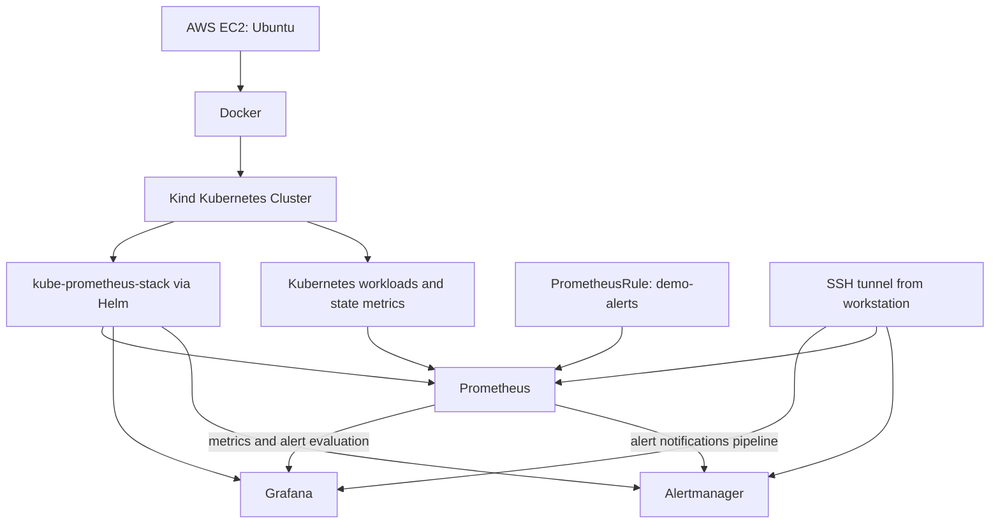

# Kubernetes Monitoring and Alerting Stack

A hands-on observability project that deploys Prometheus, Grafana, and Alertmanager into a Kind Kubernetes cluster running on an AWS EC2 Ubuntu host. The stack is installed with Helm and includes custom Prometheus alert rules.

## Architecture



Prometheus collects available metrics and evaluates alert rules. Grafana visualizes metrics. Alertmanager receives alerts from Prometheus and handles grouping/routing according to its configuration. The SSH tunnel provides local access to web interfaces without exposing their ports publicly.

## Technology stack

- AWS EC2 and Ubuntu
- Docker and Kind
- Kubernetes (`kubectl`)
- Helm
- Prometheus and Prometheus Operator
- Grafana
- Alertmanager
- PromQL and Kubernetes YAML

## What this project demonstrates

- Installing a Kubernetes monitoring stack with Helm.
- Inspecting Kubernetes resources and monitoring services.
- Defining custom alert rules with `PrometheusRule`.
- Testing an always-firing alert using `vector(1)`.
- Verifying alert status in Prometheus and Alertmanager.
- Accessing monitoring UIs through SSH tunneling.

## Prerequisites

- An Ubuntu host with Docker, Kind, `kubectl`, and Helm installed.
- A working Kind cluster.
- Network access to download Helm charts and container images.
- Enough host resources for the Kubernetes cluster and monitoring components.

Commands below assume the Helm release is named `monitoring` in the `monitoring` namespace. Adapt names if your cluster differs.

## Install the monitoring stack

Add the chart repository and update it:

```bash
helm repo add prometheus-community https://prometheus-community.github.io/helm-charts
helm repo update
```

Install the chart:

```bash
kubectl create namespace monitoring
helm install monitoring prometheus-community/kube-prometheus-stack -n monitoring
```

If the namespace or release already exists, do not rerun the install blindly. Check first:

```bash
helm list -n monitoring
kubectl get pods -n monitoring
kubectl get svc -n monitoring
```

## Verify the stack

```bash
kubectl get pods -n monitoring
kubectl get svc -n monitoring
kubectl get prometheusrules -n monitoring
```

Wait until the relevant pods are ready before opening the UIs.

## Custom alert rules

The lab uses a `PrometheusRule` named `demo-alerts` in namespace `monitoring`, with the label `release: monitoring` so the installed Prometheus Operator can select it (verify your chart's selectors if adapting this setup).

Example rule manifest (`k8s/demo-alerts.yaml`):

```yaml
apiVersion: monitoring.coreos.com/v1
kind: PrometheusRule
metadata:
  name: demo-alerts
  namespace: monitoring
  labels:
    release: monitoring
spec:
  groups:
    - name: demo.rules
      rules:
        - alert: DemoAlwaysFiring
          expr: vector(1)
          for: 0m
          labels:
            severity: warning
          annotations:
            summary: "Demo alert is firing"
            description: "This test alert always returns a value of 1."
        - alert: NginxDeploymentUnavailable
          expr: kube_deployment_status_replicas_available{namespace="default",deployment="nginx"} < 1
          for: 1m
          labels:
            severity: critical
          annotations:
            summary: "Nginx deployment has no available replicas"
            description: "The nginx deployment in the default namespace has fewer than one available replica."
```

Apply and inspect:

```bash
kubectl apply -f k8s/demo-alerts.yaml
kubectl get prometheusrule demo-alerts -n monitoring -o yaml
```

The `DemoAlwaysFiring` rule is useful for confirming the alert path. Because it always fires, remove or disable it after the demo if you want a clean alert list.

### Optional Nginx alert test

Only perform this if you want to verify the deployment availability rule. Create a test deployment if one does not already exist:

```bash
kubectl create deployment nginx --image=nginx:stable
kubectl rollout status deployment/nginx -n default
```

Scale it down and watch Prometheus Alerts. The rule has a one-minute `for` duration, so allow time for evaluation and state transition:

```bash
kubectl scale deployment/nginx --replicas=0 -n default
```

After recording the result, restore the deployment:

```bash
kubectl scale deployment/nginx --replicas=1 -n default
kubectl rollout status deployment/nginx -n default
```

Do not claim this test succeeded until you have observed `NginxDeploymentUnavailable` firing in Prometheus and confirmed the alert reached Alertmanager.

## Access the web interfaces

Use `kubectl port-forward` on the EC2 host and connect through an SSH tunnel from your workstation. Example commands (run on the EC2 host):

```bash
kubectl port-forward -n monitoring svc/monitoring-kube-prometheus-prometheus 9090:9090
kubectl port-forward -n monitoring svc/monitoring-grafana 3000:80
kubectl port-forward -n monitoring svc/monitoring-kube-prometheus-alertmanager 9093:9093
```

Run each command in a separate terminal/session, or manage them using your preferred process supervisor. If a local port is already occupied, choose another local port, for example `9094:9090`, and match the SSH tunnel's remote endpoint to the port-forward listener. In MobaXterm, configure local port forwarding from a local port to `127.0.0.1` and the corresponding listening port on the EC2 host.

Typical local URLs when forwarding to those local ports:

- Prometheus: `http://localhost:9090`
- Grafana: `http://localhost:3000`
- Alertmanager: `http://localhost:9093`

Use the actual local ports you configured. Avoid opening these monitoring ports directly to the public internet.

## Grafana

Log in with the Grafana credentials configured by the chart. For this lab, the admin password was retrieved from the Kubernetes secret rather than stored in this repository:

```bash
kubectl get secret -n monitoring monitoring-grafana -o jsonpath='{.data.admin-password}' | base64 --decode; echo
```

Do not commit passwords, kubeconfig files, tokens, or secret manifests. Import a suitable Kubernetes dashboard if desired and verify that its data sources and panels populate correctly. Dashboard ID `15757` was previously suggested during setup; verify its current compatibility and provenance before documenting it as part of the deliverable.

## Troubleshooting checklist

- **Pods not ready:** `kubectl get pods -n monitoring` and `kubectl describe pod <pod> -n monitoring`.
- **Alert rule not discovered:** check `kubectl get prometheusrule -n monitoring`, rule labels, and the Prometheus Operator's rule selectors.
- **Metric returns no data:** verify the metric exists in Prometheus and confirm the namespace/deployment labels match the real workload.
- **Port-forward stops:** restart the command and confirm the local and remote ports agree with the SSH tunnel.
- **Grafana dashboard is empty:** verify the Prometheus data source and dashboard compatibility.
- **No email or chat notification:** Alertmanager receiving an alert does not mean external notifications are configured. Configure and test a receiver separately if required.

## Future improvements

- Add a clean alert rule that is not permanently firing after the demo.
- Configure and test an Alertmanager receiver (email, Slack, or another destination).
- Add persistent storage and resource requests/limits appropriate for the lab.
- Add repeatable setup instructions and teardown steps.
- Document the Kind cluster configuration and versions of the tools used.
- Consider a production-oriented cluster and security model before describing this as production-ready.
